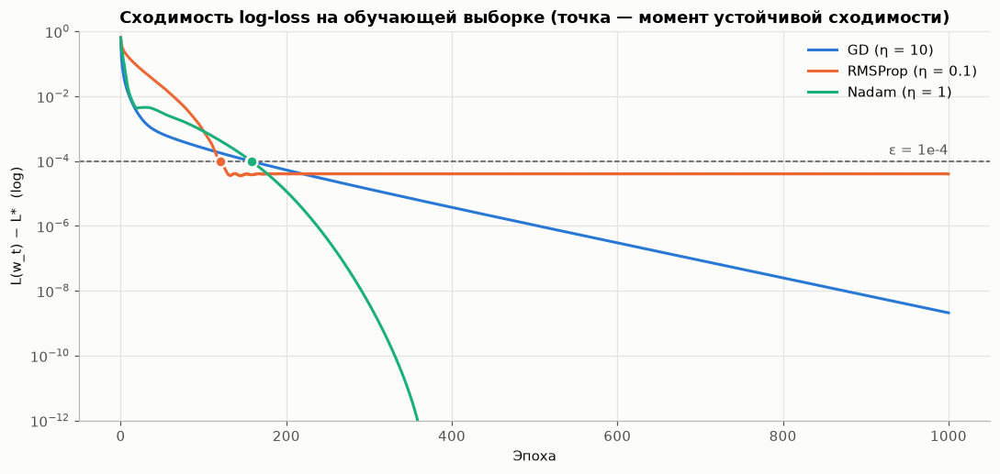
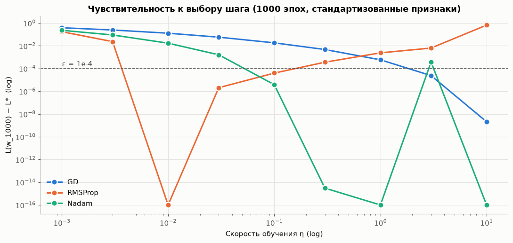
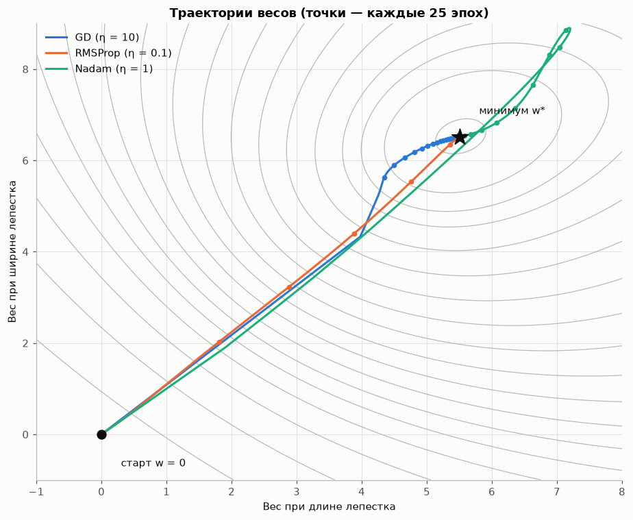
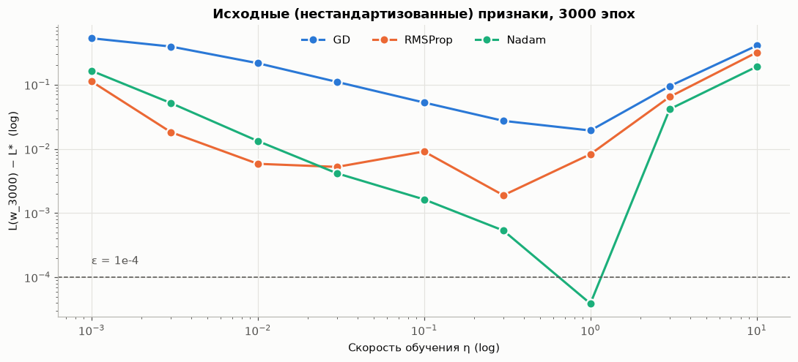

# FuncOpt — функции потерь и оптимизация

Домашнее задание **«Функции потерь и оптимизация»**. Логистическая регрессия реализована с нуля на `numpy` и обучена тремя методами: **градиентный спуск**, **RMSProp** и **Nadam**. Данные — Iris, два класса: *Versicolor* против *Virginica*.

[](https://colab.research.google.com/github/AngryAlexQA/FuncOpt/blob/main/FuncOpt.ipynb)

## Задание

1. Загрузить датасет Iris из `sklearn` и оставить два класса: Iris Versicolor и Iris Virginica.
2. Самостоятельно реализовать логистическую регрессию без `LogisticRegression` и оформить её в виде класса.
3. Реализовать градиентный спуск, обучить модель и посчитать метрику. Метрика одна и та же для всех методов.
4. Повторить п. 3 для RMSProp.
5. Повторить п. 3 для Nadam.
6. Сравнить методы в таблице |метод|метрика|время работы| и сделать вывод.

## Структура репозитория

```
FuncOpt/
├── FuncOpt.ipynb       # решение: код, пояснения, графики, выводы (ноутбук выполнен)
├── images/             # графики, сохранённые ноутбуком
├── requirements.txt    # зависимости
└── README.md
```

## Как запустить

```bash
pip install -r requirements.txt
jupyter notebook FuncOpt.ipynb
```

Можно открыть и в Google Colab по кнопке выше. Данные загружаются из `sklearn`, отдельные файлы не нужны. Полный прогон ноутбука занимает около 30 секунд.

## Что сделано

* **Модель.** Класс `MyLogisticRegression`: сигмоида, log-loss, аналитический градиент (1/n)·Xᵀ(p − y), методы `fit`, `predict_proba`, `predict`, `score`. Хранится история функции потерь и весов по эпохам.
* **Оптимизаторы** — отдельные классы с единым интерфейсом `reset()` / `step(w, grad)`: `GradientDescent`, `RMSProp`, `Nadam`. Формулы — по статье на Хабре и обзору S. Ruder.
* **Метрика** — accuracy: классы сбалансированы, а цены ошибок одинаковы. Считается на отложенном тесте (20 объектов) и на повторённой стратифицированной кросс-валидации 5 × 10.
* **Честное сравнение.** У всех методов одна стартовая точка w₀ = 0, одинаковый бюджет в 1000 эпох и одна сетка шагов η ∈ [0.001; 10]. Шаг подбирается только по train и только по функции потерь: берётся шаг с наименьшим числом эпох до устойчивой сходимости L(wₜ) − L* < 10⁻⁴. Эталонный минимум L* найден методом Ньютона.
* **Проверки.** Аналитический градиент сравнивается с численным. Веса сверяются с методом Ньютона и с `sklearn.LogisticRegression`, которая используется только для контроля.
* **Дополнительно.** Кривые сходимости, accuracy по эпохам, чувствительность к шагу, траектории весов, эксперимент на нестандартизованных признаках.

## Результаты

| Метод | Шаг η | Accuracy (test) | Accuracy (CV 5×10) | Эпох до сходимости (ε = 10⁻⁴) | Время 1000 эпох* |
|---|---|---|---|---|---|
| Градиентный спуск | 10 | **0.950** | 0.959 ± 0.047 | 157 | ≈ 45 мс |
| RMSProp | 0.1 | **0.950** | 0.954 ± 0.051 | 120 | ≈ 80 мс |
| Nadam | 1 | **0.950** | 0.954 ± 0.051 | 158 | ≈ 53 мс |

\* Время зависит от компьютера и заметно колеблется между запусками.







На **нестандартизованных** признаках задача плохо обусловлена: κ(XᵀX) ≈ 12 000. Здесь методы расходятся заметно:

| Метод | Лучший шаг η | L − L* после 3000 эпох | Сходимость | Accuracy (test) |
|---|---|---|---|---|
| Градиентный спуск | 1 | 1.9·10⁻² | не сошёлся | 0.85 |
| RMSProp | 0.3 | 1.9·10⁻³ | не сошёлся | 0.95 |
| Nadam | 1 | 3.9·10⁻⁵ | за 2501 эпоху | 0.95 |



## Выводы

1. **По метрике методы равны** (accuracy 0.95 на тесте у всех). Задача выпуклая, и все оптимизаторы приходят к одной и той же модели. Оптимизатор влияет на стоимость и надёжность получения решения, а не на итоговое качество.
2. **GD** сходится линейно, но при подобранном шаге на стандартизованных данных не уступает адаптивным методам по скорости. Эпоха у него самая дешёвая.
3. **RMSProp** быстрее всех входит в окрестность минимума (120 эпох), но затем колеблется вокруг него на уровне ~4·10⁻⁵. Это «ёжики» из статьи: при малых градиентах эффективный шаг не уменьшается.
4. **Nadam** даёт самое точное решение (разрыв < 10⁻¹² к ~360-й эпохе) и устойчив к масштабу признаков: на нестандартизованных данных сошёлся только он.
5. **Практически:** для GD стандартизация признаков обязательна. Nadam — разумный выбор «по умолчанию», которому почти не нужна настройка шага.

Подробные выводы, включая разбор различий на кросс-валидации, — в разделе 11 ноутбука.

## Источники

* П. Садовников. [Методы оптимизации нейронных сетей](https://habr.com/en/articles/318970/). Хабр.
* S. Ruder. [An overview of gradient descent optimization algorithms](https://arxiv.org/abs/1609.04747). 2016.
* T. Dozat. [Incorporating Nesterov Momentum into Adam](https://openreview.net/pdf/OM0jvwB8jIp57ZJjtNEZ.pdf). 2016.
* [sklearn.datasets.load_iris](https://scikit-learn.org/stable/modules/generated/sklearn.datasets.load_iris.html).

## Автор

Александра Бужор — Telegram [@Angry_C_F_O](https://t.me/Angry_C_F_O)
